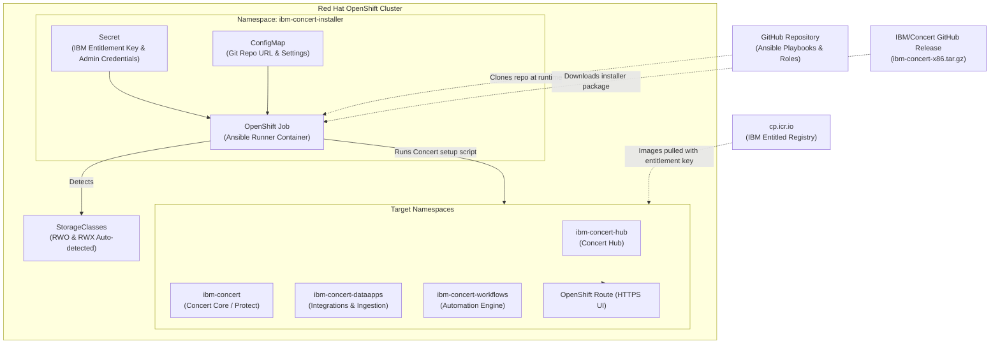

# IBM Concert Automated OpenShift Deployer

Automated, reproducible deployment of **IBM Concert** (including **Concert Protect**, **Concert Workflows**, and **Concert DataApps**) on **Red Hat OpenShift (OCP)** using Ansible.

This repository allows you to deploy the complete IBM Concert platform simply by **pasting a single YAML manifest into your OpenShift Web Console** or executing it with `oc apply -f`. The Ansible playbooks download the official IBM Concert release package (`ibm-concert-x86.tar.gz`, from the [IBM/Concert GitHub releases](https://github.com/IBM/Concert/releases)) and run its `bin/setup` script against your cluster.

---

## 🏗️ Architecture Overview



---

## 🚀 Quick Start: 1-Step OpenShift Deployment

### Step 1: Obtain your IBM Entitlement Key
1. Log in to [MyIBM Container Software Library](https://myibm.ibm.com/products-services/containerlibrary).
2. Click **Copy key** to copy your entitlement key for `cp.icr.io`.

### Step 2: Configure the Single-YAML Manifest
Open [`deploy/ocp-job-installer.yaml`](deploy/ocp-job-installer.yaml) and update the credentials section:

```yaml
apiVersion: v1
kind: Secret
metadata:
  name: concert-deployer-credentials
  namespace: ibm-concert-installer
type: Opaque
stringData:
  # Paste your IBM Entitlement Key here:
  IBM_ENTITLEMENT_KEY: "eyJh..."

  # Optional: Concert UI admin username and password (empty password = auto-generate):
  CONCERT_ADMIN_USERNAME: "concert-admin"
  CONCERT_ADMIN_PASSWORD: "MySecurePassword123!"

  # Optional: access token if the Git repository is private:
  # GIT_TOKEN: "ghp_xxxxxxxxxxxxxxxxxxxx"
```

In the `ConfigMap` section of the same file, set the URL of the GitHub repository that contains these playbooks (the Job clones it at runtime, so your changes must be pushed there):

```yaml
apiVersion: v1
kind: ConfigMap
metadata:
  name: concert-deployer-config
  namespace: ibm-concert-installer
data:
  GIT_REPO_URL: "https://github.com/<your-username>/concert-deployer.git"
  GIT_BRANCH: "main"
  HUB_NAMESPACE: "ibm-concert-hub"
  CONCERT_NAMESPACE: "ibm-concert"
  DATAAPPS_NAMESPACE: "ibm-concert-dataapps"
  WORKFLOWS_NAMESPACE: "ibm-concert-workflows"
  CONCERT_VERSION: "v3.1.0"
  CONCERT_LICENSE_ACCEPT: "true"
  ENABLE_PROTECT: "true"
  ENABLE_WORKFLOWS: "true"
  ENABLE_DATAAPPS: "true"
  STORAGE_CLASS_RWO: ""  # Auto-detected if empty (e.g. ocs-storagecluster-ceph-rbd, gp3-csi)
  STORAGE_CLASS_RWX: ""  # Auto-detected if empty (e.g. ocs-storagecluster-cephfs, nfs-client)
```

> **Alternative:** [`deploy/ocp-job-installer-template.yaml`](deploy/ocp-job-installer-template.yaml) is an OpenShift `Template` exposing the same settings as parameters. Instantiate it from the Web Console (**Add → Developer Catalog → Template**) or with `oc process -f deploy/ocp-job-installer-template.yaml -p IBM_ENTITLEMENT_KEY=<key> -p GIT_REPO_URL=<url> | oc apply -f -`. It does not support `GIT_TOKEN`.

### Step 3: Paste Manifest into OpenShift
You can apply the manifest in either of two ways:

#### Option A: Via OpenShift Web Console
1. Log into your OpenShift Web Console as a Cluster Administrator.
2. In the top-right navigation bar, click the **`+` (Import YAML)** button.
3. Copy the full content of [`deploy/ocp-job-installer.yaml`](deploy/ocp-job-installer.yaml), paste it into the editor, and click **Create**.

#### Option B: Via OpenShift CLI (`oc`)
```bash
oc apply -f deploy/ocp-job-installer.yaml
```

---

## 📊 Monitoring Installation Progress

Follow the live installation logs in OpenShift:

```bash
oc logs -f job/ibm-concert-deployer -n ibm-concert-installer
```

Once the installation completes, the job will output the final access details:

```text
================================================================================
              🎉 IBM CONCERT DEPLOYMENT ON OPENSHIFT COMPLETED                  
================================================================================
Console URL:       https://<route-host>.apps.mycluster.example.com
Admin Username:    concert-admin
Admin Password:    <Generated-Or-Configured-Password>
Namespace:         ibm-concert
Version:           v3.1.0
StorageClass RWO:  ocs-storagecluster-ceph-rbd
StorageClass RWX:  ocs-storagecluster-cephfs
--------------------------------------------------------------------------------
Installed Components:
  - IBM Concert Core:      READY
  - IBM Concert Protect:   ENABLED
  - IBM Concert Workflows: ENABLED
  - IBM Concert DataApps:  ENABLED
--------------------------------------------------------------------------------
Active Pods:       14 / 14 running
================================================================================
```

The Console URL is the host of the first OpenShift Route found in the target namespaces. The pod counts cover the `ibm-concert` namespace only.

---

## ⚙️ Configuration Reference

Settings are read from environment variables (the Job injects the Secret and ConfigMap as environment variables; see [`inventory/group_vars/all.yml`](inventory/group_vars/all.yml)).

| Parameter | Default | Description |
| :--- | :--- | :--- |
| `IBM_ENTITLEMENT_KEY` | *(Required)* | IBM Entitlement Key to pull images from `cp.icr.io`. |
| `IBM_ENTITLEMENT_USER` | `cp` | Username for the IBM registry. |
| `IBM_ENTITLEMENT_EMAIL` | `admin@ibm.com` | Email stored in the image pull secret. |
| `GIT_REPO_URL` | *(Required for Job)* | Git URL of this repository containing the Ansible playbooks. |
| `GIT_BRANCH` | `main` | Git branch to clone and execute. |
| `GIT_TOKEN` | *(unset)* | Optional token for cloning a private repository. |
| `HUB_NAMESPACE` | `ibm-concert-hub` | Namespace for Concert Hub. |
| `CONCERT_NAMESPACE` | `ibm-concert` | Namespace for IBM Concert (core/Protect). |
| `DATAAPPS_NAMESPACE` | `ibm-concert-dataapps` | Namespace for Concert DataApps. |
| `WORKFLOWS_NAMESPACE` | `ibm-concert-workflows` | Namespace for Concert Workflows. |
| `CONCERT_VERSION` | `v3.1.0` | IBM Concert release version (a missing `v` prefix is added automatically). |
| `CONCERT_LICENSE_ACCEPT` | `true` | Must be `true`, otherwise the playbook fails. |
| `CONCERT_ADMIN_USERNAME` | `concert-admin` | Administrator username. |
| `CONCERT_ADMIN_PASSWORD` | `""` | Administrator password (auto-generated if empty). |
| `ENABLE_PROTECT` | `true` | Install IBM Concert Protect (security & vulnerability management). |
| `ENABLE_WORKFLOWS` | `true` | Install IBM Concert Workflows engine. |
| `ENABLE_DATAAPPS` | `true` | Install IBM Concert DataApps (ingestion & integrations). |
| `STORAGE_CLASS_RWO` | `""` | Block/RWO storage class (auto-detected if blank). |
| `STORAGE_CLASS_RWX` | `""` | File/RWX storage class (auto-detected if blank; falls back to the RWO class). |
| `CLUSTER_INGRESS_DOMAIN` | `""` | OpenShift ingress domain (auto-discovered from the cluster if blank). |

If storage classes are not set, the playbook picks the first available of `ocs-storagecluster-ceph-rbd`, `gp3-csi`, `managed-csi`, `topolvm-provisioner` (RWO) and `ocs-storagecluster-cephfs`, `nfs-client`, `efs-sc`, `azurefile-csi` (RWX), falling back to the cluster default StorageClass for RWO.

---

## 💻 Alternative: Running Locally via CLI

If you prefer to run the Ansible deployment from your local workstation connected to OpenShift:

### 1. Prerequisites
- `oc` CLI logged into your cluster (`oc login`)
- Python 3.10+ with `pip` (required by Ansible Core 2.16+)
- Ansible Core 2.16+
- A Linux x86_64 workstation is recommended: the playbook downloads and runs the x86 Linux Concert installer package (`ibm-concert-x86.tar.gz`) and, if missing, Linux `kubectl`/`oc`/`helm`/`jq` binaries into `/tmp/bin`.

### 2. Install Dependencies
```bash
pip install -r requirements.txt
ansible-galaxy collection install -r requirements.yml
```

### 3. Run the Playbook
Configuration is passed through the same environment variables listed in the Configuration Reference above:

```bash
export IBM_ENTITLEMENT_KEY="your-key-here"
export ENABLE_WORKFLOWS=true   # optional overrides
./scripts/run-local.sh
```

The script checks that you are logged in with `oc`, prompts for the entitlement key if it is not set, installs the Ansible collections if no local `collections/` directory exists, and then runs the playbook. Extra arguments are passed through to `ansible-playbook`.

Or run Ansible directly:
```bash
ansible-playbook -i inventory/localhost.yml playbooks/install_concert.yml \
  -e "ibm_entitlement_key=${IBM_ENTITLEMENT_KEY}" \
  -e "enable_concert_protect=true" \
  -e "enable_concert_workflows=true" \
  -e "enable_concert_dataapps=true"
```

---

## 🔍 Verification & Diagnostics

To check the deployment status anytime (reports pods, routes, and the admin secret in the `ibm-concert` namespace):
```bash
ansible-playbook -i inventory/localhost.yml playbooks/verify_concert.yml
```

To list all running Concert pods (repeat for `ibm-concert-hub`, `ibm-concert-dataapps`, and `ibm-concert-workflows`):
```bash
oc get pods -n ibm-concert
```

To view the public Routes:
```bash
oc get routes -n ibm-concert
```

---

## 🧹 Uninstallation

The uninstall playbook removes only the `ibm-concert` (`CONCERT_NAMESPACE`) namespace:
```bash
ansible-playbook -i inventory/localhost.yml playbooks/uninstall_concert.yml
```
To remove everything, including the other Concert namespaces and the installer resources:
```bash
oc delete namespace ibm-concert-hub ibm-concert ibm-concert-dataapps ibm-concert-workflows
oc delete namespace ibm-concert-installer
oc delete clusterrolebinding concert-deployer-cluster-admin
```

---

## 📁 Repository Structure

```text
concert-deployer/
├── ansible.cfg                    # Ansible configuration
├── requirements.yml               # Ansible Galaxy collections (kubernetes.core, community.general)
├── requirements.txt               # Python package dependencies
├── Containerfile                  # Optional runner image (not used by the Job, which uses ubi9/python-311)
├── deploy/
│   ├── ocp-job-installer.yaml     # Single-file copy-paste OpenShift manifest
│   └── ocp-job-installer-template.yaml # OpenShift Web Console Template Wizard
├── inventory/
│   ├── localhost.yml              # Local inventory target
│   └── group_vars/
│       └── all.yml                # Configuration parameters & defaults
├── playbooks/
│   ├── install_concert.yml        # Main orchestration playbook
│   ├── verify_concert.yml         # Status & health verification playbook
│   └── uninstall_concert.yml      # Cleanup & uninstaller playbook
├── roles/
│   ├── prerequisites/             # Validation, storage/ingress discovery, namespaces, SCC bindings
│   ├── ibm_entitlement/           # Container registry pull secret creation
│   ├── concert_core/              # Downloads the Concert release package and runs its setup script
│   ├── concert_protect/           # Protect ConfigMap (scanning & remediation settings)
│   ├── concert_workflows/         # Workflows ConfigMap
│   ├── concert_dataapps/          # DataApps ConfigMap
│   └── post_install/              # Route discovery & login credentials summary
└── scripts/
    └── run-local.sh               # Local CLI helper script
```
